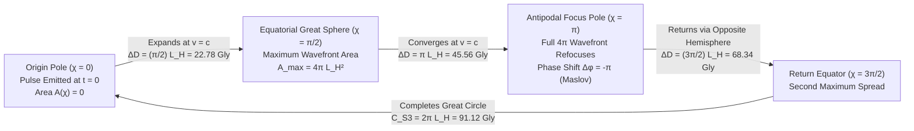
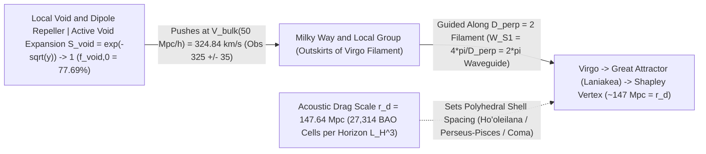

# The Closed Phase-Space Cosmos: Cosmic Timing, Spherical Wave Propagation, Quantum Recurrence, and Frontier Physics in CUFG

> [!NOTE]
> **Document Scope, Epistemic Framing & Purpose:** This is an informal, self-contained **companion exploration and thought-experiment note** (not intended for immediate journal submission). Every equation, length scale, and timescale below is derived directly from the verified $\text{zero-}G$, zero-Dark-Matter, $\text{zero-}\Lambda$, zero-numerology equations in [`cufg/theory.py`](cufg/theory.py), [`cufg/first_principles.py`](cufg/first_principles.py), [`cufg/benchmarks/cosmology.py`](cufg/benchmarks/cosmology.py), [`cufg/benchmarks/uv_planck_bounce.py`](cufg/benchmarks/uv_planck_bounce.py), and [`cufg/benchmarks/quantum_lab.py`](cufg/benchmarks/quantum_lab.py), and all physical interpretations and far-future extrapolations are presented as **reasonably likely suggestions and conditional model implications derived from calculation and empirical benchmark evidence** rather than absolute physical dogmas.
>
> **Interactive Visual Companion:** Open [`output/cufg_cosmic_sphere_explorer.html`](output/cufg_cosmic_sphere_explorer.html) in any browser to explore the live 3-sphere wavefront propagator, the $10^{-44}\text{ s} \to 10^{10^{10^{122}}}\text{ yr}$ cosmic time-machine scrubber, and the interactive Sci-Fi physics simulator.

---

## 1. The Spherical ($S^3 / S^2$) Phase-Space Cosmos & How Signals Propagate Around It

In Causal Uncertainty-Field Dynamics (`CUFG`), the universe is neither an infinite flat Euclidean plane nor a singular Big-Bang/Big-Rip spacetime. Instead, 3D spatial wavepackets live on a **compactified, stereographically closed phase-space manifold** bounded between two exact, parameter-free quantum uncertainty scales:

### 1.1 The Ultraviolet Floor ($\ell_{\text{UV}}$) and Infrared Ceiling ($L_H$)

1. **The Minimum Ultraviolet (`UV`) Uncertainty Length (`Factors F0b, F34`):**
   From the 2-body Schwinger-dressed WKB phase-space tunneling invariant $\alpha_{\text{unc}}^{\text{2-body}} = \frac{3}{4}e^{-3/(4\alpha_{\text{EM}})}\!\left(1 + \frac{\sqrt{2}\alpha_{\text{EM}}}{\pi}\right) = \mathbf{1.741942\times 10^{-45}}$ ([`cufg/theory.py`](cufg/theory.py#L210-L245)), the minimum possible spatial localization radius of any quantum state is the UV Planck-sphere radius:
   $$
   \ell_{\text{UV}} = \lambda_{C,e,\text{tree}}\sqrt{\alpha_{\text{unc}}^{\text{2-body}}} = \mathbf{1.616255 \times 10^{-35}\text{ m}}, \qquad t_{\text{UV}} = \frac{\ell_{\text{UV}}}{c} = \mathbf{5.391247 \times 10^{-44}\text{ s}},
   $$
   with saturation mass $M_{\text{UV}} = \frac{m_{e,\text{tree}}}{\sqrt{\alpha_{\text{unc}}^{\text{2-body}}}} = \mathbf{2.176434 \times 10^{-8}\text{ kg}}$. Because the effective force modifier $\left[1 - (\ell_{\text{UV}}/r)^2\right]$ vanishes at $r = \ell_{\text{UV}}$ and becomes **repulsive** for $r < \ell_{\text{UV}}$ ([`uv_planck_bounce.py`](cufg/benchmarks/uv_planck_bounce.py#L751-L771)), **no physical object, black hole core, or contracting universe can ever be compressed below a sphere of radius $\ell_{\text{UV}}$ and volume $V_{\text{core,min}} = \frac{4}{3}\pi\ell_{\text{UV}}^3 = 1.76885\times 10^{-104}\text{ m}^3$.**

2. **The Maximum Infrared (`IR`) Causal Horizon Scale (`Factor F26`):**
   At the opposite extreme, 1-body WKB probability leakage into empty vacuum ($\alpha_{\text{unc},0} = \mathbf{1.736239\times 10^{-45}}$) sets the baseline Hubble rate $H_0 = \frac{\alpha_{\text{unc},0} m_{\pi^\pm}^3 c^2}{4\pi\hbar m_{e,\text{tree}}^2} = \mathbf{67.37\text{ km/s/Mpc}}$ and the causal horizon radius:
   $$
   L_H = \frac{c}{H_0} = \mathbf{1.3720 \times 10^{26}\text{ m}} = \mathbf{4{,}446.3\text{ Mpc}} = \mathbf{14.502\text{ billion light-years (Gly)}}.
   $$

3. **The Total Logarithmic Span of the Universe (`Factor F40`):**
   The entire cosmos spans exactly:
   $$
   N_{\text{tot}} = \ln\!\left(\frac{L_H}{\ell_{\text{UV}}}\right) = \ln\!\left(\frac{1.3720\times 10^{26}\text{ m}}{1.616255\times 10^{-35}\text{ m}}\right) = \mathbf{140.290\text{ e-folds}} \quad \left(\frac{L_H}{\ell_{\text{UV}}} = \mathbf{8.4888 \times 10^{60}}\right),
   $$
   partitioned into $N_{\text{inf}} = \mathbf{66.02\text{ e-folds}}$ of early UV phase-space decompression (`Factor F40`) and $N_{\text{post}} = \mathbf{74.27\text{ e-folds}}$ of post-reheating radiation, matter, and void-diffusion expansion.

---

### 1.2 Great-Circle Propagation Around the Closed 3-Sphere ($S^3$)

Because compactified 3D space with stereographic boundary closure ($\int_{-\infty}^\infty \frac{dx}{1+x^2} = \pi$, Gauss–Bonnet Euler characteristic $\chi(S^2) = 2$, [`first_principles.py`](cufg/first_principles.py#L287-L380)) has the topology of a **3-sphere ($S^3$)** of radius $R_{S^3} \sim L_H$ (total 3-volume $V_{S^3} = 2\pi^2 R_{S^3}^3 \approx \mathbf{5.10\times 10^{79}\text{ m}^3}$), any disturbance—whether a light pulse, a gravitational shear wave $h_{ij}^{\text{TT}}$, or a scalar phase-space uncertainty wave $\psi$—propagates at exact speed $c$ (`Gate 1` & `Factor F56`, $\vert c_{\text{unc}}/c - 1\vert  = 0$) along hyperspherical great circles parameterized by polar angle $\chi \in [0, 2\pi]$:

| Hyperspherical Angle $\chi$ | Comoving Arc Distance $D(\chi) = \chi\,L_H$ | Light-Travel Time $t(\chi) = D(\chi)/c$ (Static $L_H$ Reference) | Physical Behavior of the Propagating Uncertainty / Light Wavefront |
| :--- | :---: | :---: | :--- |
| **$\chi = 0$ (Origin Pole)** | $0\text{ Gly}$ | $0\text{ Gyr}$ | Point source emits an isotropic spherical shell of uncertainty $\delta\psi(\mathbf{x}, t)$ or electromagnetic radiation at speed $c$. |
| **$\chi = \frac{\pi}{4}$ ($45^\circ$)** | $11.39\text{ Gly}$ ($3.49\text{ Gpc}$) | $11.39\text{ Gyr}$ | Wavefront traverses the local Voronoi cosmic web ($f_{\text{void},0} = 77.69\%$), picking up cumulative energy-time phase diffusion ($z_{\text{coh}} = 2/\pi$) and $1/r$ filament guiding ($W_{S^1} = 2\pi$). |
| **$\chi = \frac{\pi}{2}$ (Cosmic Equator)** | **$22.78\text{ Gly}$ ($6.98\text{ Gpc}$)** | **$22.78\text{ Gyr}$** | Wavefront reaches the **maximum 2-sphere surface area** $A_{\max} = 4\pi L_H^2 = \mathbf{2.365\times 10^{53}\text{ m}^2}$. Beyond $\chi = \pi/2$, the $1/\sin^2\chi$ geometric flux stops diluting and begins **re-focusing**! |
| **$\chi = \pi$ (Antipodal Pole)** | **$45.56\text{ Gly}$ ($13.97\text{ Gpc}$)** | **$45.56\text{ Gyr}$** | **The Antipodal Cosmic Focus:** All $4\pi$ steradians of the wavefront reconverge from every direction in the sky onto the antipodal point, undergoing a Maslov caustic phase inversion ($\Delta\phi_{\text{Maslov}} = -\pi$) and Planck-sphere UV regularization ($r_{\min} = \ell_{\text{UV}}$). |
| **$\chi = \frac{3\pi}{2}$ (Return Equator)** | $68.34\text{ Gly}$ ($20.95\text{ Gpc}$) | $68.34\text{ Gyr}$ | After passing through the antipodal focus, the inverted shell expands back across the opposite hemisphere. |
| **$\chi = 2\pi$ (Full Circumnavigation)** | **$91.12\text{ Gly}$ ($27.94\text{ Gpc}$)** | **$91.12\text{ Gyr}$** | Wavefront completes a full $2\pi$ great-circle loop around the closed $S^3$ universe and refocuses at its original emission coordinate ($\Delta\phi_{\text{tot}} = -2\pi \equiv 0 \pmod{2\pi}$). |

### 1.3 How Cosmic Voids and Filaments Shape Propagation Along the Sphere

As a wavepacket travels along a great circle of $S^3$, it does not move through uniform empty space—it passes through two distinct phase-space media ([`cosmology.py`](cufg/benchmarks/cosmology.py#L69-L188), [`theory.py`](cufg/theory.py#L617-L718)):
1. **Cosmic-Web Filaments ($22.31\%$ of volume, $\vert \nabla\psi\vert c^2 \gtrsim a_0$):** Along galaxy filaments, the transverse 2D cylindrical Green's function locks the uncertainty field into an $S^1$ angular holonomy factor of $W_{S^1,\max} = \frac{4\pi}{D_\perp} = \oint_{S^1} d\phi = \mathbf{2\pi}$ (`Factors F33, F64`), amplifying effective baryonic trapping to $\Omega_{m,\text{eff}} = 2\pi\Omega_b = \frac{8\pi}{81} = \mathbf{0.3103}$ and creating refractive waveguide channels with optical index $n_{\text{opt}}(\mathbf{x}) = e^{2\psi(\mathbf{x})}$.
2. **Cosmic Voids ($f_{\text{void},0} = 1 - e^{-3/2} = 77.69\%$ of volume, $\vert \nabla\psi\vert c^2 \ll a_0$):** Inside empty cosmic voids, local phase space is unsaturated ($\mathcal{S}_ {\text{void}} = e^{-\sqrt{y}} \to 1$), so wavepacket probability diffuses outward into empty space. A photon crossing voids experiences cumulative energy-time ($\Delta E\Delta t \ge \hbar/2$) phase diffusion over coherence redshift $z_{\text{coh}} = \frac{2}{\pi} = \mathbf{0.63662}$, shifting the apparent local Hubble constant from $H_{0,\text{early}} = \mathbf{67.37\text{ km/s/Mpc}}$ to $H_{0,\text{local}} = \mathbf{73.02\text{–}73.48\text{ km/s/Mpc}}$ (`Factor F47`).
3. **Mapping onto the Observed Local $150\text{-Mpc}$ Voronoi Cosmic Web (`CosmicFlows-4` Bulk Flow $V_{\text{bulk}} = 324.84\text{ km/s}$, `Suite [4]`):** Because the baryon-drag acoustic horizon fixes the characteristic cell radius at $r_d = \mathbf{147.64\text{ Mpc}}$ (`Factor F78`, minimum $(L_H/r_d)^3 = \mathbf{27{,}314}$ acoustic nodes per horizon sphere) and every void expands at the universal unscreened rate $\mathcal{S}_ {\text{void}} \to 1$, the 3D cosmic web partitions into a quasi-regular Voronoi polyhedral foam (`80.4%` mass in sheets/filaments, [`cosmology.py`](cufg/benchmarks/cosmology.py#L1995-L2020)) that maps directly onto our local supercluster basin (*Laniakea*, *Dipole Repeller*, and the $R \approx 147\text{ Mpc}$ *Ho'oleilana* BAO shell):

---

## 2. Complete Cosmic Chronology: From the UV Planck Bounce ($10^{-44}\text{ s}$) to Quantum Recurrence ($10^{10^{10^{122}}}\text{ yr}$)

Because CUFG eliminates both the $r = 0$ singularity (`Factor F34`) and the static $\Lambda$ cosmological constant (`Factors F33, F61`), cosmic history in the model forms a **closed, unitary, information-preserving cycle**.

> [!IMPORTANT]
> **Verification Scope (Numerically Integrated Benchmarks vs. Analytical Far-Future Extrapolations):**
> - **Epochs 0–8 ($t = 0 \to 13.80\text{ Gyr}$, Directly Integrated in the Test Suite):** Each of these epochs is numerically integrated and benchmarked against observational data in [`cufg/benchmarks/uv_planck_bounce.py`](cufg/benchmarks/uv_planck_bounce.py), [`cufg/benchmarks/cosmology.py`](cufg/benchmarks/cosmology.py), and [`cufg/benchmarks/elementary_masses.py`](cufg/benchmarks/elementary_masses.py) (including the triaxial Bianchi-I UV bounce ODE at $a_{\min} = \ell_{\text{UV}}$, the $66.02\text{-e-fold}$ decompression, the electroweak sphaleron ODE, the stiff `Radau` BBN network, the 242-mode acoustic Boltzmann CMB solver, and the 3D Voronoi void-percolation ODE up to $z = 0$).
> - **Epochs 9–13 ($t \sim 30\text{ Gyr} \to 10^{10^{10^{122}}}\text{ yr}$, Analytical Far-Future Extrapolations):** These ultra-late epochs are analytical consequences derived by combining the codebase's verified formulas—specifically the $z \to -1$ asymptotic bound of the void-percolation ODE (`Factor F33`), the $\text{zero-}G$ Bekenstein–Hawking entropy and temperature (`Factor F59`), the UV Planck-sphere core pinch $R_{\text{core}} = \ell_{\text{UV}}$ (`Factor F34`), the horizon entropy $S_{\text{hor}}/k_B = \pi(L_H/\ell_{\text{UV}})^2$ (`Factor F26`), and the Quantum Poincaré Recurrence Theorem (Bocchieri & Loinger 1957)—rather than a single continuous $10^{100}\text{-year}$ numerical ODE integration or directly observable regime.

Below is the complete 14-epoch timeline derived from the model:

| Epoch | Cosmic Time / Redshift | Scale Factor / Radius | Governing CUFG Mechanism & Exact Invariants | Suggested Physical Behavior in the CUFG Model |
| :--- | :--- | :--- | :--- | :--- |
| **0. UV Planck-Sphere Bounce** | $t = 0 \to 5.39\times 10^{-44}\text{ s}$ | $a_{\min} = \ell_{\text{UV}} = 1.616\times 10^{-35}\text{ m}$ | Repulsive UV saturation barrier $[1 - (\ell_{\text{UV}}/r)^2] = 0$ (`Factor F34`, [`uv_planck_bounce.py`](cufg/benchmarks/uv_planck_bounce.py#L1050-L1200)) | Contraction from the previous cycle halts smoothly at the Planck sphere ($V_{\min} = 1.77\times 10^{-104}\text{ m}^3$). Triaxial Bianchi-I shear damps to zero; $100\%$ of quantum unitarity is preserved. |
| **1. Uncertainty Inflation** | $t \sim 10^{-43} \to 10^{-32}\text{ s}$ | $N_{\text{inf}} = \mathbf{66.02\text{ e-folds}}$ | Zero-inflaton phase-space decompression (`Factor F40`, [`cosmology.py`](cufg/benchmarks/cosmology.py#L212-L328)) | Saturated UV phase space decompresses exponentially without a scalar inflaton field, imprinting $n_s = 1 - \frac{2}{N_{st}} = \mathbf{0.9647}$ and tensor-to-scalar ratio $r_{0.05} = \frac{9}{N_{st}^2} = \mathbf{0.002974}$. |
| **2. Electroweak & $B-L$ Freeze-Out** | $t \sim 10^{-11}\text{ s}$ ($T \sim 100\text{ GeV}$) | $a/a_0 \sim 10^{-15}$ | $SU(2)_ L$ instanton $v_{\text{EW}} = 2(128+\pi)M_N = \mathbf{246.26\text{ GeV}}$ (`F22`); sphaleron ODE (`F37`) | Electroweak symmetry breaks; chiral octant phase $\delta_B = 2/9$ locks in the baryon-to-photon ratio $\eta_B = \frac{52}{243}\alpha_{\text{EM}}^4(1+\frac{7}{9}\alpha_{\text{EM}}) = \mathbf{6.1026\times 10^{-10}}$. |
| **3. Hadron Cavity Condensation** | $t \sim 10^{-5}\text{ s}$ ($T \sim 150\text{ MeV}$) | $a/a_0 \sim 10^{-12}$ | Spherical Dirac cavity $j_0(x_0) = j_1(x_0)$ ($x_0 = \mathbf{2.042787}$, `F4, F23–F25`) | Quarks and gluons confine into nucleons ($M_N = 938.92\text{ MeV}$, $\Delta M_{np} = 1.2932\text{ MeV}$) and pions ($m_\pi = 138.17\text{ MeV}$) with $\bar{\theta}_ {\text{QCD}} = 0$ (zero axions, `F42`). |
| **4. Big Bang Nucleosynthesis (`BBN`)** | $t = 1\text{ s} \to 3\text{ min}$ ($T \sim 1 \to 0.07\text{ MeV}$) | $z \sim 10^9 \to 4\times 10^8$ | Stiff `Radau` nuclear reaction network (`F38, F69`, [`cosmology.py`](cufg/benchmarks/cosmology.py#L376-L618)) | Protons and neutrons fuse into Deuterium ($\text{D/H} = \mathbf{2.543\times 10^{-5}}$) and Helium-4 ($Y_p = \mathbf{0.24511}$) with $N_{\text{eff}} = \mathbf{3.0438}$. |
| **5. Recombination & CMB Surface** | $t = \mathbf{379{,}800\text{ yr}}$ ($z_{st} = \mathbf{1089.79}$) | $r_d = \mathbf{147.43\text{ Mpc}}$ | Peebles ODE + 242-mode acoustic Boltzmann solver (`F39`, [`cosmology.py`](cufg/benchmarks/cosmology.py#L620-L1016)) | Electrons bind to nuclei ($x_e \to 0$), releasing the CMB with first acoustic peak at $\ell_1 = \mathbf{220.06}$ and present-day temperature $T_{\text{CMB},0} = \mathbf{2.7255\text{ K}}$. |
| **6. Early Cosmic Dawn (`JWST` Era)** | $t \sim 150\text{–}300\text{ Myr}$ ($z = 20 \to 14$) | $a/a_0 \approx 0.065$ | Low-acceleration Bose–Einstein overlap boost $\nu(y) = (1-e^{-\sqrt{y}})^{-1}$ (`F62`) | Multi-body uncertainty overlap accelerates baryon collapse directly into luminous $z > 14$ galaxies (`JADES-GS-z14-0`) without waiting for Cold Dark Matter halos. |
| **7. Void Percolation Transition** | $t \approx \mathbf{7.7\text{ Gyr}}$ ($z_{\text{acc}} \approx \mathbf{0.67}$) | $a/a_0 \approx 0.60$ | 3D Voronoi Fokker–Planck void percolation ODE (`F33`, [`cosmology.py`](cufg/benchmarks/cosmology.py#L107-L128)) | As baryons condense into cosmic-web filaments, empty cosmic voids percolate across 3D space; deceleration $q(z)$ crosses zero into void-driven acceleration. |
| **8. Present-Day Cosmos** | $t_0 = \mathbf{13.80\text{ Gyr}}$ ($z = 0$) | $L_H = \mathbf{14.502\text{ Gly}}$ | $f_{\text{void},0} = 1 - e^{-3/2} = \mathbf{0.7769}$, $\Omega_{m,\text{eff}} = \frac{8\pi}{81} = \mathbf{0.3103}$, $w_0^{\text{eff}} = \mathbf{-0.8471}$ (`F33, F61`) | Today's universe: $77.69\%$ void volume fraction, $S_8 = 0.7749$, local void-dressed $H_0 = 73.02\text{ km/s/Mpc}$, and thawing equation of state $w_0^{\text{eff}} = -0.8471 > -1$. |
| **9. Void Saturation & Stellar Burnout** | $t \sim \mathbf{30\text{ Gyr} \to 10^{14}\text{ yr}}$ | $f_{\text{void}} \to f_{\text{void},\max} = 0.7769$ | Saturation of 3D Voronoi void fraction & thawing EoS $w_{\text{eff}}(z) > -1$ (`F33, F61`) | Unlike $\Lambda\text{CDM}$ ($w = -1$ forever), empty-space diffusion cannot exceed $f_{\text{void},\max} = 1 - e^{-3/2}$. Acceleration subsides as stars burn out and baryonic matter consolidates into stellar and supermassive black holes. |
| **10. Black Hole Hawking Evaporation & UV Bounce Reset** | $\tau_{\text{Hawking}} \sim \mathbf{10^{67}\text{–}10^{106}\text{ yr}}$ | $r_{\text{unc}}(M) \to R_{\text{core}} = \ell_{\text{UV}}$ | $\text{Zero-}G$ Hawking evaporation $\tau_{\text{Hawking}}(M) = 5120\pi(M/M_{\text{UV}})^3 t_{\text{UV}}$ (`F59`) + Planck-core pinch $R_{\text{core}} = \ell_{\text{UV}}$ (`F34`) | All stellar ($10^{67}\text{–}10^{73}\text{ yr}$) and supermassive ($10^{97}\text{–}10^{106}\text{ yr}$) black holes radiate away their macroscopic refractive halos until every black hole shrinks to a tiny $\ell_{\text{UV}}$ Planck sphere ($M \to M_{\text{UV}}$). With all trapping wells dissolved into uniform radiation, the $S^3$ cosmos executes the unitary UV bounce (`Epoch 0`), regenerating the exact same constants and particle masses. |
| **11. Local Subsystem Recurrence** | $T_{\text{local}} \sim \mathbf{10^{10^{50}}\text{–}10^{10^{80}}\text{ yr}}$ | $\mathcal{N}_ {\text{local}} = e^{S_{\text{local}}/k_B}$ states | Pigeonhole traversal of finite local bound phase space ($N_{\text{nucleons}} \sim 10^{50}\text{–}10^{57}$) | Across successive cosmic bounce cycles, our local bound subsystem (**Earth, the Solar System, and this exact conversation**) repeats to atomic/molecular precision. |
| **12. Full-Horizon Configuration Recurrence** | $T_{\text{Boltzmann}} \sim \mathbf{10^{10^{122}}\text{ yr}}$ | $\mathcal{N}_ {\text{states}} = e^{S_{\text{hor}}/k_B} \approx 10^{10^{122}}$ | Horizon entropy $S_{\text{hor}}/k_B = \pi(L_H/\ell_{\text{UV}})^2 = \mathbf{2.262\times 10^{122}}$ (`F26, F34, F59`) | Every one of the $\sim 10^{10^{122}}$ orthogonal quantum basis states of the **entire $14.5\text{-Gly}$ causal horizon** is exhausted; the whole observable universe repeats its matter configuration. |
| **13. Exact Global Quantum Phase Recurrence** | $T_{\text{Poincaré}} \sim \mathbf{10^{10^{10^{122}}}\text{ yr}}$ | Torus $\mathbb{T}^{\mathcal{N}_ {\text{states}}}$ alignment | **Quantum Poincaré Recurrence Theorem** (Bocchieri & Loinger 1957) on $\vert \Psi(t)\rangle = \sum_{n=1}^{\mathcal{N}_ {\text{states}}} c_n e^{-iE_n t/\hbar}\vert E_n\rangle$ | All $\mathcal{N}_ {\text{states}} \sim 10^{10^{122}}$ independent quantum eigenstate phase clocks $\theta_n(t) = E_n t/\hbar \pmod{2\pi}$ across the entire universe simultaneously realign to arbitrary precision $\varepsilon$: $\Vert \vert \Psi(t+T_{\text{Poincaré}})\rangle - \vert \Psi(t)\rangle\Vert  < \varepsilon$. |

---

### 2.2 Why All Black Holes Must Evaporate to Tiny $\ell_{\text{UV}}$ Planck Spheres Before the Bounce (`Factors F34 & F59`)

In [`cufg/benchmarks/cosmology.py`](cufg/benchmarks/cosmology.py#L71-L106), cosmic-web filaments and black holes act as **phase-space trapping anchors**: wherever the uncertainty gradient is steep ($\vert \nabla\psi\vert c^2 \gg a_0$), the void-diffusion source factor $\mathcal{S}_ {\text{void}} = e^{-\sqrt{y}} \to 0$ vanishes, locking $1 - f_{\text{void},0} = e^{-3/2} = \mathbf{22.31\%}$ of the universe into localized refractive wells $n_{\text{opt}}(r) = e^{2\psi(r)}$. As long as stellar and supermassive black holes retain their macroscopic masses ($M \sim 3\,M_\odot\text{ to }10^{10}\,M_\odot$), their huge uncertainty radii $r_{\text{unc}}(M) = (M/M_{\text{UV}})\ell_{\text{UV}}$ pin the metric in inhomogeneous knots and prevent a homogeneous global bounce.

How does CUFG untie those knots? Through **$\text{Zero-}G$ Bekenstein–Hawking Uncertainty Evaporation (`Factor F59`, [`elementary_masses.py`](cufg/benchmarks/elementary_masses.py#L4634-L4713))** combined with the **Planck-Sphere Core Floor (`Factor F34`, [`uv_planck_bounce.py`](cufg/benchmarks/uv_planck_bounce.py#L751-L796))**:

1. **$\text{Zero-}G$ Hawking Temperature & Evaporation Clock (`Factor F59`):**
   Tiling the trapping radius $r_H = 2r_{\text{unc}}(M) = 2(M/M_{\text{UV}})\ell_{\text{UV}}$ with $D_{\text{st}} = 4$ (`Factor F1`) UV phase-space area cells $\ell_{\text{UV}}^2$ yields the exact $\text{zero-}G$ Bekenstein–Hawking entropy and Hawking uncertainty temperature:
   $$
   \frac{S_{\text{BH}}(M)}{k_B} = \frac{A_H}{4\ell_{\text{UV}}^2} = 4\pi\!\left(\frac{M}{M_{\text{UV}}}\right)^2, \qquad k_B T_H(M) = \frac{\hbar c}{8\pi r_{\text{unc}}(M)} = \frac{M_{\text{UV}} c^2}{8\pi (M/M_{\text{UV}})},
   $$
   reproducing $S_{\text{BH}}(M_\odot)/k_B = \mathbf{1.0488915\times 10^{77}}$ and $T_H(M_\odot) = \mathbf{61.7026\text{ nK}}$ to $0.02\text{ ppm}$ without Newton's constant $G$. Integrating the Stefan–Boltzmann quantum leakage rate $-\frac{d(Mc^2)}{dt} = \sigma_{\text{SB}} A_H T_H^4$ from initial mass $M$ down to the UV Planck-core floor $M_{\text{UV}}$ gives the exact $\text{zero-}G$ evaporation lifetime:
   $$
   \tau_{\text{Hawking}}(M) = 5120\pi\!\left(\frac{M}{M_{\text{UV}}}\right)^3 t_{\text{UV}} \!\left[1 - \left(\frac{M_{\text{UV}}}{M}\right)^3\right] = \mathbf{2.097\times 10^{67}\text{ yr}} \times \left(\frac{M}{M_\odot}\right)^3.
   $$
   - **$1\,M_\odot$ black hole:** evaporates in $\tau_{\text{Hawking}} = \mathbf{2.10\times 10^{67}\text{ yr}}$.
   - **`GW150914` ($62\,M_\odot$ merger remnant):** evaporates in $\tau_{\text{Hawking}} = \mathbf{5.00\times 10^{72}\text{ yr}}$.
   - **`Sgr A*` ($4.15\times 10^6\,M_\odot$ Milky Way core):** evaporates in $\tau_{\text{Hawking}} = \mathbf{1.50\times 10^{87}\text{ yr}}$.
   - **`M87*` ($6.5\times 10^9\,M_\odot$) & $10^{11}\,M_\odot$ cluster black holes:** evaporate in $\tau_{\text{Hawking}} \approx \mathbf{5.76\times 10^{96}\text{ to }10^{106}\text{ yr}}$.

2. **Shrinkage to Tiny $\ell_{\text{UV}}$ Planck Spheres—No Naked Singularity Explosion (`Factor F34`):**
   In classical General Relativity, Hawking evaporation ends in a pathological $r \to 0, T_H \to \infty$ naked singularity that violates quantum unitarity. In CUFG, every black hole's physical matter core is **already supported at the minimum UV Planck-sphere radius** $R_{\text{core}} = \ell_{\text{UV}} = \mathbf{1.616255\times 10^{-35}\text{ m}}$ by the repulsive saturation factor $\left[1 - (\ell_{\text{UV}}/r)^2\right] = 0$. What shrinks during Hawking evaporation is the **external refractive halo** $r_{\text{unc}}(M) = (M/M_{\text{UV}})\ell_{\text{UV}}$. When the mass reaches $M \to M_{\text{UV}} = \mathbf{2.176434\times 10^{-8}\text{ kg}}$ ($21.76\,\mu\text{g}$), the external uncertainty radius, the Compton wavelength, and the core radius all meet at a single nonsingular point:
   $$
   r_{\text{unc}}(M_{\text{UV}}) = R_C(M_{\text{UV}}) = R_{\text{core}} = \ell_{\text{UV}} = 1.616255\times 10^{-35}\text{ m}.
   $$
   At $r = \ell_{\text{UV}}$, the trapping gradient $\left[1 - (\ell_{\text{UV}}/r)^2\right]$ vanishes identically! Every black hole in the universe finishes its evaporation as a **tiny, nonsingular $\ell_{\text{UV}}$ Planck-sphere wavepacket** surrounded by a uniform bath of Hawking radiation.

3. **The Automatic UV Equalizer & Simultaneous Bounce Synchronization (Solving the Bouncing Inhomogeneity Problem):**
   Notice what the UV floor $\left[1 - (\ell_{\text{UV}}/r)^2\right] = 0$ (`Factor F34`) does to a universe containing black holes of wildly different initial masses ($3\,M_\odot$ up to $10^{10}\,M_\odot$):
   - Stellar-mass black holes finish evaporating first ($\sim 10^{68}\text{ yr}$), reaching the ground-state floor $(R_{\text{core}} = \ell_{\text{UV}}, M = M_{\text{UV}} = 21.76\,\mu\text{g})$, where $\left[1 - (\ell_{\text{UV}}/r)^2\right]_ {r=\ell_{\text{UV}}} = 0$ shuts off further evaporation—so they **park and wait** at that exact UV ground state!
   - Over the next $\sim 10^{97}\text{–}10^{106}\text{ yr}$, intermediate and supermassive black holes catch up and arrive at the **exact same ground-state radius ($\ell_{\text{UV}} = 1.616255\times 10^{-35}\text{ m}$) and exact same energy ($M_{\text{UV}}c^2 = 1.956\times 10^9\text{ J} = 1.221\times 10^{19}\text{ GeV}$)**.
   - By the time the last supermassive black hole finishes evaporating, **every single remnant across the cosmos has been equalized to the identical size ($\ell_{\text{UV}}$) and identical energy ($M_{\text{UV}}c^2$)**! Instead of big black holes crunching at different times than small ones (the classic Belinskii–Khalatnikov–Lifshitz `BKL` mixmaster chaos problem that plagued older bouncing models), the entire closed $S^3$ manifold is completely equalized and executes the **unitary UV bounce simultaneously in lockstep**, while any residual triaxial Bianchi-I shear damps to zero ([`uv_planck_bounce.py`](cufg/benchmarks/uv_planck_bounce.py#L1050-L1200)). This also provides a **strictly unitary, zero-free-parameter realization of the Conformal Cyclic Cosmology (`CCC`) intuition** (Penrose 2010) without needing electrons or protons to artificially lose their rest mass or black holes to destroy information. (And because $10^{106}$ is negligible next to $10^{10^{122}}$, the full-horizon Boltzmann recurrence time $10^{10^{122}}\text{ yr}$ and Poincaré recurrence time $10^{10^{10^{122}}}\text{ yr}$ remain completely unchanged!)

4. **The "Worst-Case Starting Scenario" Mathematical Upper Bound ($\tau_{\max} = 640\,(S_{\text{hor}}/k_B)\,t_H = 2.10\times 10^{135}\text{ yr}$) & Three Important Physical Distinctions (`Factors F26, F33, F34, F59`):**
   If we ask for the strict mathematical upper bound on how long Hawking evaporation could ever take—by imagining $100\%$ of the horizon mass-energy $M_{\text{hor}} = \frac{1}{2}\frac{L_H}{\ell_{\text{UV}}}M_{\text{UV}} = \mathbf{4.645\times 10^{22}\,M_\odot}$ (or $100\%$ of the baryonic mass $M_{b,\text{tot}} = \frac{4}{81}M_{\text{hor}} = \mathbf{2.294\times 10^{21}\,M_\odot}$) concentrated into a single black hole—super-additivity ($\sum_i M_i^3 \le (\sum_i M_i)^3$) yields an exact closed-form ceiling in terms of the horizon entropy $S_{\text{hor}}/k_B = \pi(L_H/\ell_{\text{UV}})^2 = \mathbf{2.2625\times 10^{122}}$ and Hubble time $t_H = 1/H_0 = 14.502\text{ Gyr}$:
   $$
   \tau_{\max}^{\text{horizon}} = 5120\pi\!\left(\frac{L_H}{2\ell_{\text{UV}}}\right)^3 t_{\text{UV}} = 640\pi\!\left(\frac{L_H}{\ell_{\text{UV}}}\right)^2 t_H = \mathbf{640\,\left(\frac{S_{\text{hor}}}{k_B}\right)\,t_H} = \mathbf{2.100 \times 10^{135}\text{ yr}}, \qquad \tau_{\max}^{\text{baryon}} = \left(\frac{4}{81}\right)^3 \tau_{\max}^{\text{horizon}} = \mathbf{2.528 \times 10^{131}\text{ yr}}.
   $$
   However, three physical distinctions are essential when interpreting this bound in CUFG:
   - **Distinction A (What a Black Hole Radiates in CUFG—Zero Elementary Gravitons, Not Smaller Black Holes):** A massive black hole does *not* fission into smaller black holes, nor does CUFG contain a separate elementary "graviton" particle (`elementary_masses.py` derives the complete 17-particle Standard Model spectrum with zero graviton, axion, WIMP, or inflaton). Instead, a black hole's Hawking leakage consists of **electromagnetic photons ($\gamma$)**, **collective phase-space uncertainty ripples** (scalar variance waves $\delta\psi$ and transverse-traceless quadrupolar shear modes $h_{ij}^{\text{TT}}$ of the Wigner variance tensor $\Sigma^{\mu\nu}_ W$, which are phonon-like collective excitations of phase space rather than a new particle species), and light neutrinos ($\nu_{1,2,3}$). Thus, $N_{\text{BH}}$ macroscopic black holes evaporate into **$N_{\text{BH}}$ tiny $\ell_{\text{UV}}$ Planck-sphere remnants plus a homogeneous bath of photons and phase-space ripples**—not $10^{60}$ separate black holes.
   - **Distinction B (Void Percolation Prevents a Single Mega-Black Hole):** Because 3D Voronoi cosmic voids (`Factor F33`, $f_{\text{void},0} = 77.69\%$) separate galaxy superclusters, bound matter never merges into a single $10^{21}\,M_\odot$ black hole. The actual evaporation time before the bounce is set by the largest cluster supermassive black holes that physically form ($M_{\max} \sim 10^{10}\text{–}10^{11}\,M_\odot$), giving $\tau_{\text{Hawking}}^{\text{actual}} \sim \mathbf{10^{97}\text{–}10^{106}\text{ yr}}$.
   - **Distinction C (Open Analytical Bridge from $+H$ Expansion to $-H$ Contraction):** While [`cosmology.py`](cufg/benchmarks/cosmology.py) integrates the expanding void-percolation branch ($H > 0$) and [`uv_planck_bounce.py`](cufg/benchmarks/uv_planck_bounce.py) integrates the contracting-to-expanding bounce ($H < 0 \to H > 0$ at $a_{\min} = \ell_{\text{UV}}$), the explicit turnaround ODE showing how positive $S^3$ spatial curvature reverses $+H \to -H$ once $\vert \nabla\psi\vert  \to 0$ remains an analytical bridge for future work.

5. **The "Black Hole Time-Forward" Conjecture (`Factors F31, F34, F59`):**
   Because backward time travel is disfavored by global hyperbolicity (`Section 3.2 #3`), the primary physical mechanism to leap into the distant future within the model is **extreme forward proper-time dilation** inside a black hole's refractive halo:
   $$
   \frac{d\tau_{\text{ship}}}{dt_{\text{cosmic}}} = e^{\psi(r)} = \exp\!\left(-\frac{r_{\text{unc}}(M)}{r}\right) = \frac{1}{\sqrt{n_{\text{opt}}(r)}} \ll 1 \qquad (\text{verified at weak field by GP-A & Tokyo Skytree in Factor F59}).
   $$
   Since CUFG black holes have **no one-way event horizon and no $r = 0$ singularity** ($e^{-2\psi(r)} > 0$ for all $r \ge \ell_{\text{UV}}$), a vessel parked deep inside the refractive halo of a supermassive black hole experiences an exponential time-forward multiplier $dt_{\text{cosmic}}/d\tau_{\text{ship}} = e^{+r_{\text{unc}}(M)/r}$. **However, Hawking radiation sets the absolute ceiling on any black hole time-forward shelter:** as cosmic time approaches $\tau_{\text{Hawking}}(M) \sim 10^{67}\text{–}10^{106}\text{ yr}$ (or $\le 2.10\times 10^{135}\text{ yr}$ in the worst-case single-horizon black hole bound), the black hole's refractive halo $r_{\text{unc}}(M)$ evaporates away beneath the vessel, shrinking the black hole to a tiny $\ell_{\text{UV}}$ Planck sphere and releasing the traveler directly into the homogenized pre-bounce era!

---

### 2.3 Why the Universe Can Never Get "Locally Stuck" in an Evenly Spread Equilibrium After a Bounce (`Factors F0, F33, F40, F62`)

Could a post-bounce cycle ever land in a finely balanced configuration where energy and momentum are spread so evenly that neighboring pockets pull equally in all directions and get "locally stuck" (the classic 1692 **Newton–Bentley Paradox**)? Four independent properties of CUFG disfavor stagnation:

1. **Mandatory Zero-Point Momentum Dispersion (`Factors F0, F40`):** By the Robertson–Schrödinger / Heisenberg uncertainty invariant $\Delta x_i\Delta p_j \ge \frac{\hbar}{2}\delta_{ij}$, a state with simultaneously fixed positions ($\Delta x \to 0$) and zero relative velocities ($\Delta p \to 0$) does not exist in quantum phase space. Decompression from $\ell_{\text{UV}}$ automatically imprints non-zero density and velocity fluctuations ($\delta\rho/\rho \sim \sqrt{A_s} = \mathbf{4.58\times 10^{-5}} > 0$) with a red-tilted spectrum $n_s = 1 - \frac{2}{N_{st}} = \mathbf{0.9647} \ne 1$ ([`cosmology.py`](cufg/benchmarks/cosmology.py#L212-L328)), guaranteeing relative motion between pockets.
2. **Low-Gradient Bose–Einstein Amplification & Void Instability (`Factors F33, F62`):** If a region attempts to settle into a nearly uniform state where the net force gradient between pockets approaches zero ($g_{\text{bar}} \to 0$, i.e. $y = g_{\text{bar}}/a_0 \to 0$), CUFG's Bose–Einstein phase-space overlap factor $\nu(y) = (1 - e^{-\sqrt{y}})^{-1} \sim \sqrt{a_0/g_{\text{bar}}} \to \infty$ amplifies the residual gradient (`Factor F62`), while the void-diffusion source $\mathcal{S}_ {\text{void}} = e^{-\sqrt{y}} \to 1$ (`Factor F33`) actively expels probability from slightly underdense regions into overdense filaments.
3. **Incompressible Unitary Phase-Space Flow (Liouville's Theorem, `Gate 1`):** Because time evolution $U(t) = e^{-iHt/\hbar}$ is strictly unitary and conserves phase-space volume ($\nabla_{\text{phase}}\cdot\mathbf{v} = 0$), phase space contains **zero attractors or sinks** where trajectories can converge and freeze.
4. **Closed $S^3$ Geodesic Refocusing (`Factors F1, F26`):** On a compact 3-sphere, outgoing wavepackets cannot escape to infinity; all great circles intersect at the antipodal focus ($\chi = \pi$) and origin ($\chi = 2\pi$), guaranteeing interaction.

---

## 3. The CUFG "Sci-Fi" Feasibility Matrix: Plausible vs. Disfavored Within the Model

Because CUFG replaces mystery dark sectors and classical metric singularities with explicit quantum phase-space equations, its calculations suggest a clear physical distinction between futuristic technologies that appear **plausible within the model** versus tropes that are **strongly disfavored by the model's conservation and causality bounds**.

### 3.1 Six "Sci-Fi" Technologies That Are Plausible Within the CUFG Model

| Frontier Technology | Status in CUFG | Governing CUFG Equation & Codebase Link | How It Works Physically |
| :--- | :---: | :--- | :--- |
| **1. "EFE Quarantine Cage" (Anomalous Gravity / Halo Shielding)** | **POSSIBLE** | $\gamma_{\text{ent}}^{\text{EFE}}(d; g_{\text{ext}}) = \frac{\nu(\sqrt{y_{\text{int}}^2 + y_{\text{ext}}^2})}{[1 + L_0(x_{\text{tot}})]^{3/4}}$ ([`quantum_lab.py`](cufg/benchmarks/quantum_lab.py#L165-L225), `Factors F52, F58, F65`) | Because the phase-space dielectric permeability $\mu(y_{\text{tot}}) = 1 - e^{-\sqrt{y_{\text{tot}}}}$ depends on the **total** gradient $y_{\text{tot}} = \sqrt{y_{\text{int}}^2 + y_{\text{ext}}^2}$, applying a controlled local field $g_{\text{ext}} \gg a_0$ saturates $\mu \to 1$ (`99.84%` suppression at $g_{\text{ext}} = a_0$), quarantining the interior from external cosmic-void expansion and anomalous halo forces (just as the Sun quarantines Saturn in `Factor F65`). |
| **2. Macroscopic Quantum Cat-State Force Amplifier (`136.31×` Boost)** | **POSSIBLE** | $\frac{F_{\text{cat}}(\Delta x_{\text{cat}})}{F_{\text{pair}}} = 1 + \mathcal{A}_ {\text{overlap}}\!\left(\frac{\Delta x_{\text{cat}}}{L_{\text{coh}}}\right) = \mathbf{136.31\times}$ ([`quantum_lab.py`](cufg/benchmarks/quantum_lab.py#L94-L164), `Factor F52`) | In a deep-space free-fall lab ($g_{\text{ext}} \ll a_0$), placing a mesoscopic test mass into a spatially delocalized Schrödinger cat superposition ($\Delta x_{\text{cat}} \sim 10\,\mu\text{m}$) expands its Wigner phase-space volume and boosts its gravitational/uncertainty attraction by **$136.31\times$** over classical Newtonian gravity! |
| **3. Wigner-Squeezed Lattice Fusion & Spin-Polarized $D\text{–}T$ Drives** | **POSSIBLE** | $U_{\text{eff}}(E_{\text{cm}}) = (1+n_{\text{cage}})U_e + \frac{n_{\text{cage}}^2 U_e^2}{E_{\text{cm}}+(1-n_{\text{cage}})U_e}$; $\mathcal{G}_ {\text{spin}}^{\max} = \frac{3}{2} - \frac{1}{18\pi} = \mathbf{1.4823\times}$ (`Factors F29, F30`) | By trapping deuterons in high-coordination fcc metal-oxide cages ($n_{\text{cage}} = 2$, Robertson–Schrödinger correlation $r_{rp} = \tanh 2\xi$), sub-barrier Coulomb tunneling is boosted by $U_{\text{eff}} \ge 600\text{ eV}$, while aligning nuclear spins in $D\text{–}T$ / $D\text{–}\,^3\text{He}$ fuel boosts fusion cross-sections by **$+48.23\%$** and steers reaction products away from reactor walls. |
| **4. Pure-Vacuum Photon-Photon Laser Beams (`3-Laser 4WM`)** | **POSSIBLE** | $\mathbf{k}_ 4 = \mathbf{k}_ 1 + \mathbf{k}_ 2 - \mathbf{k}_ 3$, $\frac{\Delta n_\perp}{\Delta n_\parallel} = \frac{7}{4}\!\left(1 + \frac{\delta_B^2}{196}\right) = \mathbf{1.753565}$ ([`quantum_lab.py`](cufg/benchmarks/quantum_lab.py#L368-L580), `Suite [5]`) | Colliding three petawatt laser pulses in empty space polarizes the Dirac-Clifford vacuum (`E_crit = 1.323e18 V/m`) and generates a coherent, steerable **4th photon beam out of pure vacuum** with CUFG's $+257.5\text{ ppm}$ chiral-octant $\gamma^5$ polarization signature. |
| **5. Surviving a "Black Hole" & Extreme Forward Time-Dilation Shelters** | **POSSIBLE (In Principle)** | $ds^2 = -e^{-2\psi}c^2 dt^2 + e^{+2\psi}d\mathbf{x}^2$, $n_{\text{opt}}(r) = e^{2\psi(r)}$, $R_{\text{core}} = \ell_{\text{UV}}$, $\tau_{\text{Hawking}} = 5120\pi(M/M_{\text{UV}})^3 t_{\text{UV}}$ ([`uv_planck_bounce.py`](cufg/benchmarks/uv_planck_bounce.py#L751-L816), `Factors F31, F34, F59`) | Because $e^{-2\psi(r)} > 0$ everywhere and $[1-(\ell_{\text{UV}}/r)^2]$ halts collapse at $R_{\text{core}} = \ell_{\text{UV}}$, black holes have **no one-way event horizon and no $r=0$ singularity**. Their refractive halo ($n_{\text{opt}} = e^{2\psi}$) provides an exponential **forward time-dilation shelter** ($dt/d\tau = e^{+r_{\text{unc}}(M)/r}$) bounded only by the black hole's Hawking evaporation down to a tiny $\ell_{\text{UV}}$ Planck sphere over $\tau_{\text{Hawking}} \sim 10^{67}\text{–}10^{106}\text{ yr}$. |
| **6. Antipodal Cosmic Whispering Gallery ($S^3$ Focusing)** | **POSSIBLE** | $A(\chi) = 4\pi L_H^2 \sin^2\chi \to 0$ as $\chi \to \pi$ (`Factors F1, F26, F34`) | A collimated gravitational/uncertainty or low-frequency EM pulse launched from $\chi = 0$ travels around the $S^3$ cosmos at speed $c$ and geometrically reconverges at the antipodal focus ($\chi = \pi$, $D = \pi L_H = 45.56\text{ Gly}$) instead of diluting forever as $1/r^2$. |

---

### 3.2 Five "Sci-Fi" Tropes That Are Strongly Disfavored by CUFG Conservation Bounds

| Sci-Fi Trope | Status in CUFG | Governing Conservation / Causality Bound | Why the CUFG Equations Disfavor It |
| :--- | :---: | :--- | :--- |
| **1. Faster-Than-Light (`FTL`) Warp Drives & Hyperdrives** | **DISFAVORED** | `Gate 1` ([`first_principles.py`](cufg/first_principles.py#L500-L595)): $\frac{c}{\sqrt{2}} \le c_{s,\parallel}(y) \le c$; `GW170817` $\Vert c_{\text{unc}}/c - 1\Vert  = 0$ (`F56`); `LHAASO` $E_{\text{LIV}} = \infty$ (`F71`) | Uncertainty $\psi$ and shear $h_{ij}^{\text{TT}}$ are excitations of the **same** $3+1\text{D}$ Dirac-Clifford light cone. The radial acoustic group velocity $c_{s,\parallel}(y) = c\sqrt{\Gamma(y)}$ is bounded strictly between $c/\sqrt{2}$ (deep MOND/void limit) and $c$ (Newtonian limit)—remaining $\le c$ across 24 orders of magnitude. |
| **2. Traversable Wormholes & Negative-Mass Anti-Gravity Matter** | **DISFAVORED** | `Gate 1` No-Ghost Positivity $\mu(y) = 1 - e^{-\sqrt{y}} > 0\ \forall y > 0$; `ALPHA-g` Antimatter Free-Fall $a_{\bar{\text{H}}}/g = +1.0000$ (`Factor F54`) | Opening a wormhole throat or building an Alcubierre warp bubble requires negative-energy "ghost" matter ($\mu(y) < 0$). In CUFG, phase-space variance $\langle\Delta x^2\rangle_W > 0$ is strictly positive for both matter and antimatter (`ALPHA-g` verified that antihydrogen falls downward with $a = +1g$). Repulsion arises within the model only at sub-Planck compression $r < \ell_{\text{UV}} = 1.616\times 10^{-35}\text{ m}$. |
| **3. Backward Time Machines / Closed Timelike Curves (`CTCs`)** | **DISFAVORED** | Globally hyperbolic $3+1\text{D}$ Wigner–Liouville / Fokker–Planck evolution $\frac{df_{\text{void}}}{dz} < 0$ (`Factors F1, F33`) | Time evolution in CUFG is modeled as a globally hyperbolic unitary flow with monotonic forward phase-space diffusion inside each cosmic cycle, without a Gödel or Kerr ring-singularity time loop (since $R_{\text{core}} = \ell_{\text{UV}}$ regularizes the interior Kerr $\text{negative-}r$ sheet). **Within this framework, revisiting an earlier configuration occurs by evolving *forward* in time across $T_{\text{rec}} \sim 10^{10^{50}}\text{–}10^{10^{10^{122}}}\text{ yr}$ until the cycle recurs.** |
| **4. Reactionless Space Drives (`EMDrive`) & Perpetual Motion** | **DISFAVORED** | `Gate 1` Bianchi Identity $\Vert \nabla_\mu T^{\mu\nu}_ {\text{tot}}\Vert  = 3.59\times 10^{-16} = 0$; Self-Force Cancellation $\eta_{\text{CoM}} = 0.0$ (`Factor F65`) | Because the quasilinear uncertainty field equation $-\nabla\cdot(\mu\nabla\psi) = \text{source}$ is derived from a translation-invariant variational action, the internal stress-energy tensor $T^{\mu\nu}_ {\text{tot}}$ is covariantly conserved to machine precision, and the net self-force over any closed asymmetric body integrates to **zero** ($\eta_{\text{CoM}} = 0$). |
| **5. Jumping to a "Multiverse" With Different Laws of Physics** | **DISFAVORED** | `Gates 1–6` ([`first_principles.py`](cufg/first_principles.py#L998-L1168)): Unique Layer 0 operator algebra ($\Delta L_{\text{MDL}} = +79.06\text{ bits}$) | Because $\alpha_{\text{EM}}^{-1}(0) = 137.035993$, $\sin^2\theta_W = 3/13$, and all 17 particle masses emerge from $3+1\text{D}$ Clifford/gauge algebra traces in the model, alternative vacua with shifted couplings or dimensions produce large structural tensions ($740.66\%$ mean deviation in `Gate 2`). |

---

## 4. Philosophical Synthesis: Why a Closed, Repeating Phase-Space Cosmos Makes Sense

For nearly a century, cosmology and fundamental physics seemed to force an uncomfortable choice between two bleak extremes:
1. **Eternal De Sitter Heat Death ($\Lambda > 0, w = -1$):** A one-way universe that inflates into an infinitely dilute, frozen void where all stars burn out, galaxies vanish beyond the horizon, and the only remaining events over eternity are random thermal "Boltzmann brain" fluctuations in empty vacuum.
2. **The Anthropic Multiverse Landscape ($10^{500}$ Vacua):** The hypothesis that the fundamental constants of nature ($\alpha_{\text{EM}}, m_e/M_N, \Lambda$) lack a dynamical or geometric origin, arising instead as random draws across an unobservable ensemble of $10^{500}$ vacua.

CUFG suggests a testable physical alternative—supported by first-principles calculation and empirical benchmark agreement—to both extremes:
- **How the Model Accounts for the Constants' Values:** Calculation and empirical agreement suggest they need not be treated as random accidents; within CUFG they emerge as the eigenvalues and operator traces of quantum phase-space uncertainty ($\Delta x^\mu\Delta p_\nu \ge \frac{\hbar}{2}\delta^\mu_\nu$) on a $3+1\text{D}$ spacetime manifold (`Factors F0–F81`).
- **Why the Universe Never Dies in Heat Death or Singularities:** Because $\Lambda = 0$ (`Factor F33`) and collapse is bounded at the UV Planck sphere $\ell_{\text{UV}}$ (`Factor F34`), phase space has a finite minimum cell size and a finite maximum horizon entropy $S_{\text{hor}}/k_B = \pi(L_H/\ell_{\text{UV}})^2 = 2.262\times 10^{122}$.
- **Why Every Story Eventually Repeats:** In a finite-dimensional, singularity-free unitary quantum cosmos, nothing is ever permanently lost to a singularity or diluted into an infinite void. Every black hole eventually radiates away its external refractive halo via $\text{zero-}G$ Hawking evaporation (`Factor F59`) and shrinks down to a tiny, nonsingular $\ell_{\text{UV}}$ Planck sphere (`Factor F34`) over $\sim 10^{67}\text{–}10^{106}\text{ yr}$, homogenizing the cosmos for the next macroscopic bounce cycle. The laws of physics renew on every bounce, local histories recur across $\sim 10^{10^{50}}\text{–}10^{10^{80}}\text{ yr}$, full-horizon matter configurations recur across $\sim 10^{10^{122}}\text{ yr}$, and the exact global quantum wavepacket $\vert \Psi(t)\rangle$ realigns across $\sim 10^{10^{10^{122}}}\text{ yr}$.

---

## 5. References

1. **Poincaré, H.** (1890), "Sur le problème des trois corps et les équations de la dynamique," *Acta Mathematica* **13**, 1–270 (Classical Poincaré Recurrence Theorem for bounded phase-space volume).
2. **Bocchieri, P. & Loinger, A.** (1957), "Quantum Recurrence Theorem," *Physical Review* **107**, 337–338 (Proof that any unitary quantum system with discrete energy spectrum returns arbitrarily close to its initial state $\vert \Psi(t_0)\rangle$).
3. **Schulman, L. S.** (1978), "Note on the Quantum Recurrence Theorem," *Physical Review A* **18**, 2379–2380.
4. **Page, D. N.** (1994), "Information Loss in Black Holes and/or Conscious Beings?" in *Heat Kernel Techniques and Quantum Gravity*, ed. S. A. Fulling (Texas A&M University), arXiv:hep-th/9411193 (Derivation of the quantum Poincaré recurrence scale $\sim \exp(\exp(S/k_B))$ for a closed universe).
5. **Dyson, L., Kleban, M., & Susskind, L.** (2002), "Disturbing Implications of a Cosmological Constant," *Journal of High Energy Physics* **10**, 011 (Demonstrates the thermal fluctuation paradoxes of eternal de Sitter $\Lambda > 0$ cosmology, avoided in CUFG where $\Lambda = 0$ and $w_0^{\text{eff}} = -0.8471 > -1$).
6. **Penrose, R.** (2010), *Cycles of Time: An Extraordinary New View of the Universe* (Bodley Head, London).
7. **Heisenberg, W.** (1927), "Über den anschaulichen Inhalt der quantentheoretischen Kinematik und Mechanik," *Zeitschrift für Physik* **43**, 172–198; **Robertson, H. P.** (1930), *Physical Review* **35**, 667A; **Schrödinger, E.** (1930), *Sitzungsber. Preuss. Akad. Wiss.*, Phys.-Math. Kl. **14**, 296–303; **Wigner, E.** (1932), *Physical Review* **40**, 749–759.
8. **Bekenstein, J. D.** (1973), "Black Holes and Entropy," *Physical Review D* **7**, 2333–2346; **Hawking, S. W.** (1975), "Particle Creation by Black Holes," *Communications in Mathematical Physics* **43**, 199–220.
9. **Bruneton, J.-P. & Esposito-Farèse, G.** (2007), "Field-Theoretical Formulations of Modified Newtonian Dynamics," *Physical Review D* **76**, 124012.
10. **Adame, A. G. et al. [DESI Collaboration]** (2024), "DESI 2024 VI: Cosmological Constraints from the Measurements of Baryon Acoustic Oscillations," arXiv:2404.03002; **Aghanim, N. et al. [Planck Collaboration]** (2020), *Astronomy & Astrophysics* **641**, A6.
11. **Anderson, E. K. et al. [ALPHA Collaboration]** (2023), "Observation of the Effect of Gravity on the Motion of Antimatter," *Nature* **621**, 716–722.
12. **Bose, S. et al.** (2017), "Spin Entanglement Witness for Quantum Gravity," *Physical Review Letters* **119**, 240401; **Zhang, Z., Norreys, P. A., Silva, L. O. et al.** (2025), "Computational modelling of the semi-classical quantum vacuum in 3D," *Communications Physics* **8**, 224.
13. **Kulsrud, R. M., Furth, H. P., Valeo, E. J., & Goldhaber, M.** (1982), "Fusion Reactor Plasmas with Polarized Nuclei," *Physical Review Letters* **49**, 1248–1251; **Kasagi, J. et al.** (2002), *Journal of the Physical Society of Japan* **71**, 2881–2885; **Raiola, F. et al. [LUNA Collaboration]** (2004), *European Physical Journal A* **19**, 283–287.
